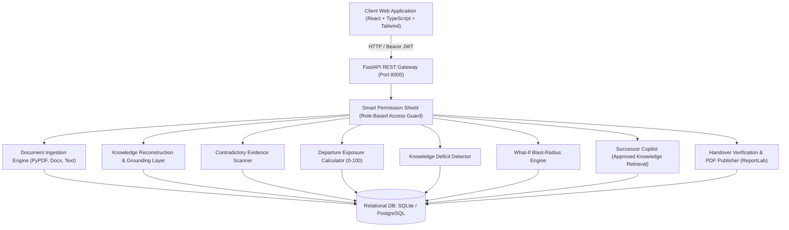

# System Architecture & Technical Specifications

**Product Name:** Knowledge Continuity  
**Tagline:** Preserve Knowledge. Continue Progress.

---

## 1. High-Level Architecture Overview

---

## 2. Core Architectural Principles

1. **Strict Evidence Lineage:**
   Every candidate fact extracted by the system maintains an exact relationship with an `ExtractedPassage`, including document name, page number, section heading, and character offsets. Factual claims cannot exist without traceable evidence.

2. **Zero-Hallucination Philosophy:**
   The AI layer operates on verified evidence. If evidence conflicts between two documents, the platform refuses to silently guess; instead, it generates an `EvidenceConflict` record requiring human resolution. If information is missing, it creates a `KnowledgeGap`.

3. **Backend-Enforced Role Separation:**
   Incoming successors are cryptographically and query-filtered from seeing unapproved drafts, rejected claims, or unresolved conflicts. Permissions are never merely visual frontend button disables.

4. **Deterministic & Provider-Agnostic Engine:**
   Operates out-of-the-box with 100% deterministic, high-precision pattern parsing with zero external API dependencies or costs. Generative LLMs (Gemini / OpenAI) can be enabled via server-side environment variables without altering the core data contracts.

---

## 3. Database Schema Models

- **`User`**: Corporate identity, title, hashed password, role metadata.
- **`Workspace`**: Tenant boundary grouping projects and team members.
- **`Project`**: Core continuity unit with target handover date and exposure metrics.
- **`ProjectMember`**: Role association (`workspace_admin`, `project_owner`, `reviewer`, `contributor`, `successor`).
- **`Document`**: Raw uploaded asset metadata, parsing status, text stream.
- **`ExtractedPassage`**: Verifiable chunks with page number, section, and char offsets.
- **`Claim`**: Granular knowledge unit (`decision`, `completed_task`, `unfinished_task`, `responsibility`, `dependency`, `risk`, `milestone`) with verification status.
- **`EvidenceConflict`**: Contradiction record linking Claim A and Claim B with human resolution logs.
- **`Risk`**: Radar risk items categorized by bottleneck, severity, and mitigation.
- **`KnowledgeGap`**: Identified context void with recommended clarifying questions.
- **`SimulationScenario`**: Saved What-If blast radius models with evidence grounding and metric deltas.
- **`Handover`**: Master handover package with versioning, summary, and sign-off timestamps.
- **`HandoverChecklistItem`**: 9 mandatory enterprise handover domains.
- **`AuditEvent`**: Immutable compliance record of human reviews and publishing events.
